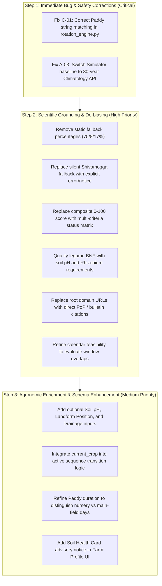

# KRISHIORBIT – Phase 7.8: Comprehensive Scientific Validation Audit

**Audit Target:** KRISHIORBIT Agro-Climatic Intelligence & Decision-Support System  
**Repository:** `https://github.com/vikaskvgowda40-tech/KRISHIORBIT.git` (Commit `10dd7c0`)  
**Local Workspace:** `C:\Users\K V VIKAS\OneDrive\Documents\Nasa\KRISHIORBIT`  
**Audit Date:** November 15, 2026  
**Audit Standard:** ICAR, UAS Bengaluru, UAHS / KSNUAHS Shivamogga Package of Practices, FAO-56, WMO Climate Normal Standards, NASA POWER Documentation  
**Audit Policy:** Strictly Research, Verification, and Documentation. No code, database, configuration, or UI edits were performed. Local SQLite database (`krishiorbit.db`) and saved farm profiles remain completely intact.

---

## Executive Summary

This Phase 7.8 Scientific Validation Audit provides a thorough, code-level and scientific examination of the KRISHIORBIT platform following Phase 7.7A architectural hardening. KRISHIORBIT integrates real satellite-derived agro-meteorological estimates from NASA POWER with agricultural package of practices from Indian agricultural universities (ICAR, UAS Bengaluru, KSNUAHS Shivamogga).

While Phase 7.7A successfully separated perennial plantation palms (Arecanut) from the annual rotation engine, integrated the 30-year NASA POWER Climatological Baseline (1991–2020), and removed arbitrary score cutoff bands, this audit identifies critical scientific discrepancies, an active string-matching logic bug in rotation evaluation, uncalibrated heuristic scores, and data gaps that must be reconciled before deployment to farming communities.

---

## Section A: NASA POWER Data & Meteorological Handling

### Finding A-01: Proportional Fallback Rainfall Allocation Creates Synthetic Precision
- **File & Line Number:** [backend/rotation_engine.py](file:///C:/Users/K%20V%20VIKAS/OneDrive/Documents/Nasa/KRISHIORBIT/backend/rotation_engine.py#L292-L315)
- **Existing Behavior or Claim:**
  When `monthly_summary` is missing or empty, `_extract_seasonal_climate()` calculates seasonal rainfall using hardcoded static percentages of annual precipitation:
  ```python
  ann_precip = float(annual_summary.get("total_precipitation_mm", 0.0))
  if assigned_season == "Kharif":
      return {"seasonal_rainfall_mm": round(ann_precip * 0.75, 2), ...}
  elif assigned_season == "Rabi":
      return {"seasonal_rainfall_mm": round(ann_precip * 0.08, 2), ...}
  elif assigned_season == "Summer":
      return {"seasonal_rainfall_mm": round(ann_precip * 0.17, 2), ...}
  ```
- **Scientific Concern:**
  These static fractions (75% Kharif, 8% Rabi, 17% Summer) represent a gross generalization that fails across Karnataka's distinct agro-climatic zones. In the Coastal Zone (Zone 10) and Hilly/Malnad Zone (Zone 9), Kharif precipitation often exceeds 85–90% of annual rainfall, while Summer pre-monsoon showers (Mango showers) vary widely (5–12%). In the Southern Dry Zone (Zone 6) and Eastern Dry Zone (Zone 5), Rabi (North-East monsoon) contributes 25–35% of annual rainfall. Calculating seasonal rainfall by multiplying an arbitrary percentage creates synthetic precision and misleads the water evaluation module.
- **Evidence Needed:**
  Agro-climatic rainfall distribution normals from the India Meteorological Department (IMD) or spatial coordinates-based monthly averages from the NASA POWER 30-year climatology.
- **Recommended Correction:**
  Eliminate static proportional fallbacks entirely. If monthly summary records are absent, the engine must set `seasonal_rainfall_mm = None`, flag `is_partial_data = True`, and explicitly warn the user that seasonal precipitation could not be resolved from satellite observations.
- **Priority:** High

---

### Finding A-02: Hardcoded Shivamogga Data in Rotation Comparison Network Fallback
- **File & Line Number:** [backend/main.py](file:///C:/Users/K%20V%20VIKAS/OneDrive/Documents/Nasa/KRISHIORBIT/backend/main.py#L1113-L1143)
- **Existing Behavior or Claim:**
  When `/api/rotation/compare` encounters an exception connecting to NASA POWER, it silently falls back to a hardcoded 2026 dataset:
  ```python
  except Exception:
      climate_res = {
          "status": "partial",
          "annual_summary": {
              "avg_temperature_c": 25.24,
              "total_precipitation_mm": 903.22,
              ...
          },
          "monthly_summary": [
              {"month": "2026-01", "total_precipitation_mm": 0.69, ...},
              ...
          ]
      }
  ```
- **Scientific Concern:**
  The fallback dataset is specific to Shivamogga coordinates for early 2026 (903.22 mm precipitation). If a farmer evaluates a parcel in Vijayapura (Northern Dry Zone, ~550 mm annual rainfall) or Udupi (Coastal Zone, ~3800 mm annual rainfall) during a network glitch, the system silently applies Shivamogga's climate, providing dangerously misleading recommendations.
- **Evidence Needed:**
  Standard fault-tolerant design protocols for agricultural decision support systems.
- **Recommended Correction:**
  Do not silently substitute location-specific data with hardcoded foreign coordinates. The endpoint should raise an explicit HTTP 503 (Service Unavailable) error or return `status: "failed_telemetry"` with a prominent user-facing warning that live coordinates-specific satellite data could not be acquired.
- **Priority:** High

---

### Finding A-03: Temporal Misalignment of Daily Year-to-Date (YTD) Observations for Seasonal Rotations
- **File & Line Number:** [backend/main.py](file:///C:/Users/K%20V%20VIKAS/OneDrive/Documents/Nasa/KRISHIORBIT/backend/main.py#L192-L194), [backend/rotation_engine.py](file:///C:/Users/K%20V%20VIKAS/OneDrive/Documents/Nasa/KRISHIORBIT/backend/rotation_engine.py#L318-L349)
- **Existing Behavior or Claim:**
  The daily NASA endpoint defaults to `effective_start = 20260101` and queries up to the current date. The rotation engine evaluates crops across Kharif (June–October), Rabi (November–February), and Summer (March–May) from this single-year dataset.
- **Scientific Concern:**
  1. **Rabi season spanning years:** The Rabi agricultural season in South India begins in October/November of Year $N$ and terminates in January/February of Year $N+1$. A single YTD query starting January 1, 2026 truncates November and December of the active cropping sequence.
  2. **Incomplete trailing season:** When queried in November 2026, the Rabi season contains only 11 days of data, yet the rotation engine evaluates this incomplete period as the entire Rabi moisture regime unless the user cross-checks `is_partial_data`.
  3. **Operational vs Planning data:** Daily satellite telemetry represents *recent weather*, not long-term *climate suitability*. Agricultural crop rotation planning requires 30-year historical climatological baselines to determine probability distributions of dry spells and thermal thresholds.
- **Evidence Needed:**
  WMO Guide to Climatological Practices (WMO-No. 100) and FAO-56 irrigation and crop water requirement standards.
- **Recommended Correction:**
  Configure the Crop Rotation Simulator to utilize `/api/nasa-power/climatology` (1991–2020 30-year normal) as its primary biophysical foundation for scenario comparison, reserving `/api/nasa-power` (daily telemetry) exclusively for current in-season tactical monitoring.
- **Priority:** Critical

---

### Finding A-04: Hardcoded Agro-Climatic Zone String in Daily NASA Endpoint
- **File & Line Number:** [backend/main.py](file:///C:/Users/K%20V%20VIKAS/OneDrive/Documents/Nasa/KRISHIORBIT/backend/main.py#L476)
- **Existing Behavior or Claim:**
  ```python
  "location": {
      "latitude": latitude,
      "longitude": longitude,
      "elevation_m": elevation,
      "region": "Shivamogga / Western Ghats Agro-Climatic Zone, Karnataka, India"
  }
  ```
- **Scientific Concern:**
  The `region` attribute is statically hardcoded as `"Shivamogga / Western Ghats Agro-Climatic Zone, Karnataka, India"` regardless of the `latitude` and `longitude` passed into the request. If coordinates for Raichur (16.20°N, 77.35°E) or Hassan (13.00°N, 76.10°E) are submitted, the response metadata claims the farm is in Shivamogga.
- **Evidence Needed:**
  Administrative and agro-climatic boundaries of Karnataka (Karnataka State Remote Sensing Applications Centre - KSRSAC).
- **Recommended Correction:**
  Remove the hardcoded region string or compute it dynamically based on verified coordinate bounding boxes. Replace with: `"Gridded reanalysis cell centered at Lat {latitude}°N, Lon {longitude}°E"`.
- **Priority:** Medium

---

## Section B: Crop Intelligence & Agronomic Verification

All nine cataloged crop profiles in `backend/database.py` and `frontend/src/components/CropIntelligence.jsx` were audited against published ICAR and UAS Package of Practices (PoP).

```
+----+----------------------+-------------------+-----------------------+---------------------+
| ID | Crop Name            | Category          | Duration (Cataloged)  | Water Req (mm)      |
+----+----------------------+-------------------+-----------------------+---------------------+
| 1  | Paddy (Rice)         | Cereal            | 110–150 days          | 1100–1400 mm        |
| 2  | Ragi (Finger Millet) | Nutri-Cereal      | 105–125 days          | 350–500 mm          |
| 3  | Maize                | Cereal            | 90–115 days           | 500–650 mm          |
| 4  | Black Gram (Urad)    | Pulse             | 70–85 days            | 250–350 mm          |
| 5  | Green Gram (Moong)   | Pulse             | 60–75 days            | 250–350 mm          |
| 6  | Arecanut (Palm)      | Plantation        | Perennial (>25-35 yr) | 1500–2500 mm        |
| 7  | Cowpea               | Pulse             | 70–90 days            | 300–450 mm          |
| 8  | Groundnut            | Oilseed / Legume  | 100–120 days          | 450–600 mm          |
| 9  | Soybean              | Pulse / Oilseed   | 90–105 days           | 450–600 mm          |
+----+----------------------+-------------------+-----------------------+---------------------+
```

### Finding B-01: Generic Root Domain URLs Disguised as Reference Citations
- **File & Line Number:** [backend/database.py](file:///C:/Users/K%20V%20VIKAS/OneDrive/Documents/Nasa/KRISHIORBIT/backend/database.py#L60), [L84](file:///C:/Users/K%20V%20VIKAS/OneDrive/Documents/Nasa/KRISHIORBIT/backend/database.py#L84), [L108](file:///C:/Users/K%20V%20VIKAS/OneDrive/Documents/Nasa/KRISHIORBIT/backend/database.py#L108), [L133](file:///C:/Users/K%20V%20VIKAS/OneDrive/Documents/Nasa/KRISHIORBIT/backend/database.py#L133), [L158](file:///C:/Users/K%20V%20VIKAS/OneDrive/Documents/Nasa/KRISHIORBIT/backend/database.py#L158), [L185](file:///C:/Users/K%20V%20VIKAS/OneDrive/Documents/Nasa/KRISHIORBIT/backend/database.py#L185), [L210](file:///C:/Users/K%20V%20VIKAS/OneDrive/Documents/Nasa/KRISHIORBIT/backend/database.py#L210), [L236](file:///C:/Users/K%20V%20VIKAS/OneDrive/Documents/Nasa/KRISHIORBIT/backend/database.py#L236), [L263](file:///C:/Users/K%20V%20VIKAS/OneDrive/Documents/Nasa/KRISHIORBIT/backend/database.py#L263)
- **Existing Behavior or Claim:**
  The `reference_url` fields in `backend/database.py` point exclusively to institute top-level homepages:
  - Paddy: `https://icar-iirr.org`
  - Ragi: `https://millets.res.in`
  - Maize: `https://iimr.icar.gov.in`
  - Black Gram: `https://iipr.icar.gov.in`
  - Green Gram: `https://iipr.icar.gov.in`
  - Arecanut: `https://cpcri.icar.gov.in`
  - Cowpea: `https://www.uasbangalore.edu.in`
  - Groundnut: `https://dgr.icar.gov.in`
  - Soybean: `https://iisrindore.icar.gov.in`
- **Scientific Concern:**
  Top-level homepages do not provide verifiable evidence for specific numerical claims (e.g., rainfall bounds, water requirement, or nitrogen fixation numbers). When a user clicks "View Scientific Profile" in the frontend modal, they are directed to landing pages with news banners and institutional directories rather than the source Package of Practices or research bulletin.
- **Evidence Needed:**
  Direct URLs to published PDFs, technical bulletins, or digital extensions (e.g., UAS Bangalore Package of Practices for Field Crops, ICAR-IIPR Pulses Technical Bulletins).
- **Recommended Correction:**
  Update database seed records to reference specific documents or official PoP digital repositories (as cataloged in `agricultural_final_reconciliation_phase_7_6_4.md`).
- **Priority:** High

---

### Finding B-02: Over-Generalized Biological Nitrogen Fixation (BNF) Quantifications
- **File & Line Number:** [backend/database.py](file:///C:/Users/K%20V%20VIKAS/OneDrive/Documents/Nasa/KRISHIORBIT/backend/database.py#L129-L131), [L154-L156](file:///C:/Users/K%20V%20VIKAS/OneDrive/Documents/Nasa/KRISHIORBIT/backend/database.py#L154-L156), [L206-L208](file:///C:/Users/K%20V%20VIKAS/OneDrive/Documents/Nasa/KRISHIORBIT/backend/database.py#L206-L208), [L232-L234](file:///C:/Users/K%20V%20VIKAS/OneDrive/Documents/Nasa/KRISHIORBIT/backend/database.py#L232-L234), [L259-L261](file:///C:/Users/K%20V%20VIKAS/OneDrive/Documents/Nasa/KRISHIORBIT/backend/database.py#L259-L261)
- **Existing Behavior or Claim:**
  Fixed nitrogen credits are stated as guaranteed quantities:
  - Black Gram: "35–45 kg atmospheric N/ha"
  - Green Gram: "30–40 kg N/ha"
  - Cowpea: "40–55 kg atmospheric N/ha"
  - Groundnut: "40–60 kg N/ha"
  - Soybean: "60–80 kg N/ha"
- **Scientific Concern:**
  Stating BNF as an unqualified point range violates agronomic science. In Karnataka's Western Ghats and Malnad regions, laterite soils frequently exhibit pH < 5.2. Acid soil infertility suppresses native *Rhizobium* viability, induces molybdenum deficiency (co-factor for nitrogenase enzyme), and causes phosphorus fixation. Under such conditions, actual BNF can drop to near zero unless the soil is limed and seed is inoculated with effective biofertilizer strains. Furthermore, high residual nitrogen in the root zone suppresses nodulation.
- **Evidence Needed:**
  ICAR-IIPR and UAS Bengaluru agronomic research on symbiotic nodulation under acid soil conditions.
- **Recommended Correction:**
  Amend nitrogen fixation descriptions across all five legumes to include mandatory edaphic qualifiers:
  *"Potential biological nitrogen fixation under optimal soil conditions (pH 6.0–7.5, adequate available phosphorus, and verified Rhizobium nodulation). In acid laterites (pH < 5.5), liming and biofertilizer seed inoculation are required to realize these benefits."*
- **Priority:** High

---

### Finding B-03: Nursery Duration Omission in Paddy Growing Days
- **File & Line Number:** [backend/database.py](file:///C:/Users/K%20V%20VIKAS/OneDrive/Documents/Nasa/KRISHIORBIT/backend/database.py#L48), [backend/rotation_engine.py](file:///C:/Users/K%20V%20VIKAS/OneDrive/Documents/Nasa/KRISHIORBIT/backend/rotation_engine.py#L32-L46)
- **Existing Behavior or Claim:**
  Paddy duration is listed as "110–150 days (varies by variety: short 110–120d, medium 120–135d, long 140–150d)". The duration parser extracts `130` days.
- **Scientific Concern:**
  In Karnataka rice systems (transplanted puddle paddy), the crop spends 25–30 days in the seedling nursery and 100–120 days in the main field. For rotation scheduling, main-field occupancy determines when the succeeding post-monsoon (Rabi) crop can be sown. Using seed-to-seed duration without distinguishing main-field occupancy distorts relay cropping feasibility.
- **Evidence Needed:**
  ICAR-IIRR Rice Production Technology Manual and UAS Bengaluru Package of Practices.
- **Recommended Correction:**
  Clarify duration breakdown in `database.py`: `"115–140 days seed-to-seed (includes 25–30 days in nursery; main-field occupancy 90–110 days)"`.
- **Priority:** Medium

---

## Section C: Crop Rotation Dynamics & Evaluation Engine

### Finding C-01: Critical Logic Bug in Paddy String Matching Inside Rotation Engine
- **File & Line Number:** [backend/rotation_engine.py](file:///C:/Users/K%20V%20VIKAS/OneDrive/Documents/Nasa/KRISHIORBIT/backend/rotation_engine.py#L897)
- **Existing Behavior or Code:**
  ```python
  "potential_limitations": (
      rotation_eval["risks"] +
      [f"Drainage management: {farm.get('soil_type', 'Laterite')} in high-rainfall spells requires raised beds or drainage furrows to avoid standing water."
       if "paddy" not in [c["crop_name"].lower() for c in sequence_crops]
       else "Lowland paddies require perimeter bunding to hold saturated water depths."]
  )
  ```
- **Scientific Concern:**
  In `backend/database.py`, the official crop name is `"Paddy (Rice)"`.  
  The list comprehension `[c["crop_name"].lower() for c in sequence_crops]` produces `['paddy (rice)']`.  
  The Python membership check `"paddy" not in ['paddy (rice)']` evaluates to **`True`** because `"paddy"` is not identical to `"paddy (rice)"`!  
  Consequently, **whenever a farmer simulates a rotation containing Paddy, the engine outputs the incorrect upland recommendation** (*"requires raised beds or drainage furrows to avoid standing water"*) instead of the lowland rice management recommendation (*"Lowland paddies require perimeter bunding to hold saturated water depths"*). This is an active bug resulting directly from exact string comparison.
- **Evidence Needed:**
  Direct code execution and verification against the crop catalog dictionary.
- **Recommended Correction:**
  Replace the exact membership check with a substring check:
  ```python
  if not any("paddy" in c["crop_name"].lower() for c in sequence_crops)
  ```
- **Priority:** Critical

---

### Finding C-02: Calendar Feasibility Evaluated by Simple Day Summation Rather Than Transition Windows
- **File & Line Number:** [backend/rotation_engine.py](file:///C:/Users/K%20V%20VIKAS/OneDrive/Documents/Nasa/KRISHIORBIT/backend/rotation_engine.py#L655-L692)
- **Existing Behavior or Claim:**
  `evaluate_calendar_and_season()` sums duration integers across sequence crops:
  ```python
  total_days = sum(_parse_duration_days(c.get("growing_duration_days", "")) for c in sequence_crops)
  if total_days <= 240:
      score = 10; status = "Optimal"
  elif total_days <= 320:
      score = 8; status = "Moderate"
  else:
      score = 5; status = "Challenging"
  ```
- **Scientific Concern:**
  Sequential double-cropping feasibility is not governed by whether $\sum \text{days} \le 240$ or $320$. It is governed by **temporal alignment with agro-climatic boundaries**:
  - In Malnad/Zone 9, Kharif Paddy sown in July is harvested in late November. Sowing Rabi Black Gram or Cowpea in December fails because residual topsoil moisture in the plow layer is exhausted by late December, and winter minimum temperatures drop to 12°C–14°C, arresting germination.
  - Sowing a 115-day Kharif crop followed by a 75-day Rabi crop gives $115 + 75 = 190 \text{ days} \le 240$ (flagged as "Optimal"), but if Kharif sowing was delayed to August due to late monsoon onset, the Rabi crop faces catastrophic terminal moisture stress.
- **Evidence Needed:**
  UAS Bengaluru PoP Crop Calendar Guidelines for Southern Transition Zone (Zone 7) and Hilly Zone (Zone 9).
- **Recommended Correction:**
  Transition the calendar evaluation from a simple integer summation to a calendar-window check that evaluates the expected harvest date of Crop 1 against the latest recommended sowing window of Crop 2.
- **Priority:** High

---

### Finding C-03: Simplified Cereal-Pulse Pathogen Dynamics
- **File & Line Number:** [backend/rotation_engine.py](file:///C:/Users/K%20V%20VIKAS/OneDrive/Documents/Nasa/KRISHIORBIT/backend/rotation_engine.py#L576-L623)
- **Existing Behavior or Claim:**
  The engine assumes that rotating any pulse after any cereal universally "breaks pest and disease cycles" (+3 points).
- **Scientific Concern:**
  While rotating across botanical families reduces many host-specific monophagous pests (e.g., Yellow Stem Borer in rice), several destructive soil-borne pathogens are polyphagous and infect both cereals and pulses:
  - *Rhizoctonia solani* causes sheath blight in rice and root/collar rot in soybean, cowpea, and groundnut.
  - *Fusarium oxysporum* species complexes persist across diverse cropping sequences.
  - Broad-spectrum soil nematodes (*Meloidogyne graminicola*) attack both aerobic rice and subsequent pulse crops.
- **Evidence Needed:**
  ICAR-IIRR and ICAR-IIPR Plant Pathology Compendiums.
- **Recommended Correction:**
  Qualify rotational pest-break benefits to specify fungal foliar and insect cycles (e.g., stem borers, leaf folders) while adding an agronomic caution regarding shared soil-borne damping-off fungi (*Rhizoctonia* / *Fusarium*) in poorly drained parcels.
- **Priority:** Medium

---

### Finding C-04: Verification of Perennial Palm (Arecanut) Blockade
- **File & Line Number:** [backend/rotation_engine.py](file:///C:/Users/K%20V%20VIKAS/OneDrive/Documents/Nasa/KRISHIORBIT/backend/rotation_engine.py#L799-L808), [backend/main.py](file:///C:/Users/K%20V%20VIKAS/OneDrive/Documents/Nasa/KRISHIORBIT/backend/main.py#L1093-L1104)
- **Existing Behavior or Code:**
  Any rotation scenario submitted to `/api/rotation/compare` or `compare_rotation_scenarios()` that contains Arecanut is immediately rejected with HTTP 400 Bad Request:
  ```python
  if "arecanut" in c_name or "plantation" in c_cat:
      raise HTTPException(
          status_code=400,
          detail="Crop 'Arecanut' is a perennial plantation palm (30–40 year economic lifespan) and cannot be evaluated in an annual seasonal crop rotation sequence..."
      )
  ```
- **Scientific Verification:**
  **PASSED.** The architectural separation implemented in Phase 7.7A is functioning perfectly. Arecanut cannot be submitted or simulated in any annual rotation sequence.
- **Residual Finding:** In `rotation_engine.py#L227-L232`, legacy season-assignment logic (`if "perennial" in crop_seasons or "arecanut" in crop_name: return "Perennial"`) remains in dead code branches and should eventually be cleanly pruned.
- **Priority:** Low

---

## Section D: Farm Profile Data Utilization & Missing Agricultural Inputs

### Finding D-01: Underutilized Farm Profile Fields (`total_land_acres` and `current_crop`)
- **File & Line Number:** [backend/main.py](file:///C:/Users/K%20V%20VIKAS/OneDrive/Documents/Nasa/KRISHIORBIT/backend/main.py#L747-L762), [backend/rotation_engine.py](file:///C:/Users/K%20V%20VIKAS/OneDrive/Documents/Nasa/KRISHIORBIT/backend/rotation_engine.py#L780-L845)
- **Existing Behavior or Claim:**
  The `FarmProfile` model requires `total_land_acres` and `current_crop`. Both are persisted in SQLite and displayed in the UI.
- **Scientific Concern:**
  1. `total_land_acres` is completely ignored by the rotation comparison engine. It has zero effect on crop feasibility, mechanization viability, or risk evaluation. Smallholders (< 2 acres) have different labor and risk constraints compared to medium/large holdings.
  2. `current_crop` is displayed, but `evaluate_rotation_dynamics()` evaluates rotational benefits solely against `previous_crop`. If a farmer is currently growing Paddy in the field right now, the immediate succeeding crop should evaluate rotation dynamics against `current_crop`, not `previous_crop`.
- **Evidence Needed:**
  Farming systems research methodology (ICAR-IIFSR Modipuram).
- **Recommended Correction:**
  Incorporate `current_crop` into the sequence transition check as the baseline crop for the upcoming season, and document parcel size constraints.
- **Priority:** Medium

---

### Finding D-02: Critical Agronomic Inputs Missing from Farm Profile Schema
- **File & Line Number:** [backend/main.py](file:///C:/Users/K%20V%20VIKAS/OneDrive/Documents/Nasa/KRISHIORBIT/backend/main.py#L714-L745), [backend/database.py](file:///C:/Users/K%20V%20VIKAS/OneDrive/Documents/Nasa/KRISHIORBIT/backend/database.py#L274-L297)
- **Existing Behavior or Claim:**
  The system captures: `village`, `district`, `state`, `latitude`, `longitude`, `total_land_acres`, `soil_type`, `current_crop`, `previous_crop`, `farming_season`, `irrigation_type`, `primary_priority`.
- **Scientific Concern:**
  A comprehensive agricultural decision-support engine requires several vital edaphic and topographical inputs that are currently absent:
  1. **Soil Reaction (pH):** Essential for diagnosing acidity in Western Ghats laterites and salinity in black soils.
  2. **Soil Electrical Conductivity (EC):** Determines salinity stress for sensitive pulses.
  3. **Effective Rooting Depth & Hardpan Presence:** Indurated laterite crusts (ferricrete) at 30–50 cm depth restrict taproot penetration for pigeon pea, cotton, and maize.
  4. **Topographical Landform Position (Bailu vs. Majalu vs. Makki):** In Malnad valleys, topographical elevation dictates hydrological regime:
     - *Bailu* (valley floor): high water table, waterlogging risk, ideal for puddle rice.
     - *Majalu* (mid-slopes): moderate drainage, flexible for rice or pulses.
     - *Makki* (upland terraced ridge): rapid drainage, prone to moisture stress, unsuited for puddle rice.
  5. **Slope & Soil Erosion Class:** Influences runoff potential during high-intensity monsoon events.
- **Evidence Needed:**
  National Bureau of Soil Survey and Land Use Planning (NBSS&LUP) soil mapping protocols for Karnataka.
- **Recommended Correction:**
  Introduce an "Advanced Soil & Parcel Profile" section in the database schema and UI with optional fields for pH, Topography (Lowland/Midland/Upland), Hardpan Depth, and Drainage Class, with clear default fallbacks when unmeasured.
- **Priority:** High

---

## Section E: Scientific Transparency & Heuristic Scoring

### Finding E-01: Retention of Arbitrary Heuristic Score (0–100) Creates False Numerical Certainty
- **File & Line Number:** [backend/rotation_engine.py](file:///C:/Users/K%20V%20VIKAS/OneDrive/Documents/Nasa/KRISHIORBIT/backend/rotation_engine.py#L841-L880), [frontend/src/components/CropRotationSimulator.jsx](file:///C:/Users/K%20V%20VIKAS/OneDrive/Documents/Nasa/KRISHIORBIT/frontend/src/components/CropRotationSimulator.jsx#L815-L842)
- **Existing Behavior or Claim:**
  The engine calculates a single scalar score out of 100:
  ```python
  total_heuristic_score = round(soil_score + water_score + rotation_eval["score"] + thermal_score + calendar_eval["score"], 1)
  ```
  with hardcoded weights: Soil (25) + Water (25) + Rotation Dynamics (20) + Thermal (20) + Calendar (10) = 100.
  Although labeled *"Biophysical Criteria Alignment (Qualitative)"* with an unvalidated heuristic disclaimer, the UI and API still output a precise number (e.g., `83.5 / 100`).
- **Scientific Concern:**
  Publishing a single composite numerical score conveys false scientific precision. A score of 84.5 versus 81.0 leads farmers to believe Scenario A is empirically 3.5% "better" than Scenario B. In reality, the difference stems from arbitrary internal integer increments (+3 for legume, -2 for sand, etc.). Crop suitability is fundamentally multidimensional; a scenario with perfect soil, thermal, and rotation alignment will still fail completely if seasonal water is zero. Linear additive scoring allows high points in one domain to mask a fatal deficiency in another.
- **Evidence Needed:**
  Multi-Criteria Decision Analysis (MCDA) in agricultural systems (FAO Land Evaluation Framework).
- **Recommended Correction:**
  Deprecate the single composite numerical score (0–100) entirely. Replace it with a **Categorical Biophysical Alignment Matrix**:
  - Soil Compatibility: `Optimal` | `Moderate` | `Challenging`
  - Water & Moisture Security: `Sufficient` | `Buffer Required` | `Deficit Risk`
  - Rotational Soil Biology: `Restorative` | `Neutral` | `Depletive`
  - Thermal Safety: `Within Bounds` | `Thermal Sterility Risk`
  - Seasonal Calendar: `Feasible` | `Tight Window` | `Overlap Risk`
- **Priority:** High

---

### Finding E-02: Arbitrary Point Deductions in Soil Compatibility Matrix
- **File & Line Number:** [backend/rotation_engine.py](file:///C:/Users/K%20V%20VIKAS/OneDrive/Documents/Nasa/KRISHIORBIT/backend/rotation_engine.py#L49-L158)
- **Existing Behavior or Code:**
  ```python
  # Example point allocations:
  soil_score = 25  # Optimal
  soil_score = 20  # Moderate
  soil_score = 16  # Challenging
  soil_score = 14  # Groundnut in black soil
  soil_score = 12  # Paddy in sandy soil
  ```
- **Scientific Concern:**
  The distinction between 14 points (groundnut in black soil) and 12 points (paddy in sandy soil) is uncalibrated and lacks empirical foundation. While the qualitative explanations are agronomically accurate (peg penetration difficulties in vertisols; percolation losses in sands), attaching arbitrary numbers gives a veneer of quantitative modeling that is scientifically indefensible.
- **Evidence Needed:**
  NBSS&LUP Soil-Site Suitability Criteria for Karnataka.
- **Recommended Correction:**
  Retain the categorical status (`Optimal`, `Moderate`, `Challenging`) and the detailed agronomic rationales, but discontinue the arbitrary integer deductions.
- **Priority:** Medium

---

### Finding E-03: Lack of Prominent Soil Health Card & Laboratory Testing Disclaimers in UI
- **File & Line Number:** [frontend/src/components/FarmProfile.jsx](file:///C:/Users/K%20V%20VIKAS/OneDrive/Documents/Nasa/KRISHIORBIT/frontend/src/components/FarmProfile.jsx), [frontend/src/components/CropIntelligence.jsx](file:///C:/Users/K%20V%20VIKAS/OneDrive/Documents/Nasa/KRISHIORBIT/frontend/src/components/CropIntelligence.jsx)
- **Existing Behavior or Claim:**
  The Farm Profile module allows users to select broad soil names ("Laterite soil", "Red soil", "Black soil") and proceed directly to crop simulation without any disclaimer highlighting the necessity of actual soil laboratory assays.
- **Scientific Concern:**
  Broad soil taxonomy describes general physical texture and geological genesis, but cannot inform farmers about available nitrogen, phosphorus, potassium, micronutrient deficiencies (zinc, boron), organic carbon levels, or soil acidity. Providing rotational advice without urging farmers to obtain a certified Soil Health Card (SHC) risks unscientific input application.
- **Evidence Needed:**
  Operational Guidelines of the Soil Health Card Scheme, Ministry of Agriculture & Farmers Welfare, Government of India.
- **Recommended Correction:**
  Add a persistent advisory notice on the Farm Profile form:
  *"Notice: Soil classifications in this profile represent generalized regional textural profiles. Certified laboratory testing (Soil Health Card) is strongly recommended to determine exact pH, organic carbon, and nutrient status prior to planting."*
- **Priority:** Medium

---

## Section F: Audit Synthesis & Recommended Implementation Order

### Audit Summary Table

| Finding ID | Module | Issue Summary | Scientific Severity | Priority |
| :--- | :--- | :--- | :--- | :--- |
| **C-01** | Rotation Engine | Bug in Paddy string match (`"paddy" not in ['paddy (rice)']`) | Critical Code Logic Bug | **Critical** |
| **A-03** | NASA API & Engine | Single-year YTD query creates severe Rabi seasonal misalignment | Severe Temporal Distortion | **Critical** |
| **A-01** | Rotation Engine | Fallback rainfall allocates static percentages (75%, 8%, 17%) | Uncalibrated Heuristic | **High** |
| **A-02** | Main API | Network failure silently falls back to Shivamogga data | Geographic Displacement Risk | **High** |
| **B-01** | Crop Intelligence | Reference URLs point to generic institutional homepages | Unverifiable Citations | **High** |
| **B-02** | Crop Intelligence | Unqualified biological nitrogen fixation claims across legumes | Incomplete Agronomic Context | **High** |
| **C-02** | Rotation Engine | Calendar feasibility based on simple day sum rather than dates | Seasonal Transition Risk | **High** |
| **D-02** | Farm Profile | Absence of pH, topography position, and hardpan depth inputs | Critical Edaphic Omission | **High** |
| **E-01** | Rotation Engine / UI | Retention of single composite 0–100 heuristic score | Misleading Precision | **High** |
| **A-04** | NASA API | Hardcoded Shivamogga agro-climatic zone string in metadata | Metadata Inaccuracy | **Medium** |
| **B-03** | Crop Intelligence | Omission of nursery duration in Paddy seed-to-seed duration | Calendar Inaccuracy | **Medium** |
| **C-03** | Rotation Engine | Over-simplified pathogen break assertions across cereals/pulses | Shared Soil-borne Pathogens | **Medium** |
| **D-01** | Farm Profile | `current_crop` and `total_land_acres` ignored in simulation logic | Underutilized Field Inputs | **Medium** |
| **E-02** | Rotation Engine | Uncalibrated integer point deductions in soil compatibility | Arbitrary Precision | **Medium** |
| **E-03** | UI (Profiles) | Missing Soil Health Card laboratory testing advisory | Missing Scientific Guidance | **Medium** |
| **C-04** | Perennial Palm | Arecanut strictly blocked from annual sequences | Verified Safe Architecture | **Low (Passed)** |

---

### Recommended Implementation Roadmap



1. **Step 1 — Immediate Bug & Safety Corrections (Critical Priority):**
   - Correct the list-membership string match bug in `rotation_engine.py#L897` so that selecting Paddy generates the correct lowland drainage guidance.
   - Establish `/api/nasa-power/climatology` (the verified 1991–2020 normal) as the primary climate input for the Crop Rotation Simulator, resolving the single-year Rabi truncation bug.

2. **Step 2 — Scientific Grounding & De-biasing (High Priority):**
   - Remove the uncalibrated proportional fallback (75%, 8%, 17%) in `_extract_seasonal_climate()`.
   - Remove silent fallback to Shivamogga weather data upon API timeout in `/api/rotation/compare`.
   - Deprecate the single composite numerical score (0–100) in both backend and frontend, adopting pure categorical multi-criteria alignment indicators.
   - Amend all legume nitrogen fixation claims to explicitly state soil pH and *Rhizobium* inoculation prerequisites.
   - Update database reference URLs to point directly to published technical documents and Package of Practices manuals.

3. **Step 3 — Agronomic Enrichment & Profile Schema Expansion (Medium Priority):**
   - Enhance the Farm Profile schema to accept optional advanced fields: Soil pH, Landform Topography (Lowland/Midland/Upland), and Drainage Class.
   - Update sequence transitions to evaluate rotation dynamics against `current_crop` when active.
   - Add Soil Health Card laboratory testing disclaimers across the Farm Profile creation form and Crop Intelligence modals.
